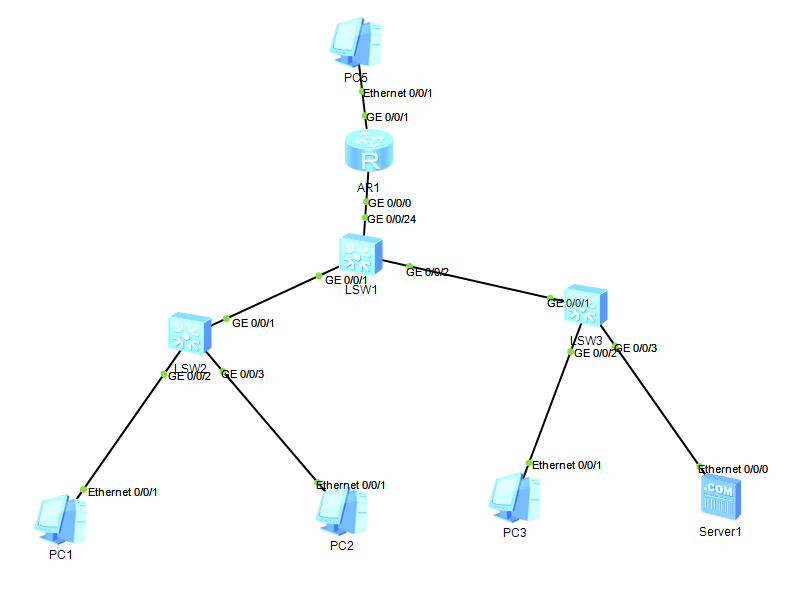

# 01 · 中小型企业网络规划与部署

在 eNSP 中搭建一个典型的中小型企业网络：双接入交换机 + 三层核心 + 出口路由器，实现内网多业务隔离、终端自动获取地址、内网互通并访问外网。

---

## 一、网络拓扑



拓扑文件：[`topology.topo`](topology.topo)（eNSP 工程文件，可直接打开复现）

> 打开后各设备为**出厂空配置**（eNSP 的 `flash.efz` 设备镜像未纳入版本库），按 [`config/`](config/) 下对应文件逐台粘贴即可还原实验环境。设备互联关系、型号、IP 规划均已在 `topology.topo` 中保留。

### 逻辑视图

```
                      PC5 (200.1.1.2)
                            │ 模拟外网
                     GE0/0/1│
                     ┌──────┴──────┐
                     │     AR1     │  出口路由器（ASBR）
                     │   AR2220    │
                     └──────┬──────┘
              GE0/0/0 10.0.0.2/30
                            │
                     10.0.0.0/30
                            │
              GE0/0/24 10.0.0.1/30
                     ┌──────┴──────┐
                     │    LSW1     │  核心交换机（三层）
                     │   S5700     │
                     └──┬───────┬──┘
              GE0/0/1   │       │  GE0/0/2
              （Trunk） │       │  （Trunk）
                 ┌──────┴──┐ ┌──┴──────┐
                 │  LSW2   │ │  LSW3   │  接入交换机
                 │  S3700  │ │  S3700  │
                 └─┬────┬──┘ └──┬────┬─┘
            GE0/0/2│    │GE0/0/3 │GE0/0/2│GE0/0/3
                   │    │        │      │
                  PC1  PC2      PC3   Server1
                VLAN10 VLAN20  VLAN30  VLAN99
                技术部 市场部   访客   服务器区
```

---

## 二、网段与 VLAN 规划

| VLAN | 用途 | 网段 | 网关（VLANIF） | 地址分配 |
|---|---|---|---|---|
| 10 | 技术部 | 192.168.10.0/24 | 192.168.10.254 | DHCP |
| 20 | 市场部 | 192.168.20.0/24 | 192.168.20.254 | DHCP |
| 30 | 访客区 | 192.168.30.0/24 | 192.168.30.254 | DHCP |
| 99 | 服务器区 | 192.168.99.0/24 | 192.168.99.254 | 静态 |
| 200 | 核心↔出口互联 | 10.0.0.0/30 | 10.0.0.1 | — |
| — | 模拟外网 | 200.1.1.0/30 | 200.1.1.1 | 静态 |

**接口连接关系**

| 设备 | 接口 | 类型 | VLAN | 对端 |
|---|---|---|---|---|
| LSW1 | GE0/0/1 | Trunk | 10, 20 | LSW2 GE0/0/1 |
| LSW1 | GE0/0/2 | Trunk | 30, 99 | LSW3 GE0/0/1 |
| LSW1 | GE0/0/24 | Access | 200 | AR1 GE0/0/0 |
| LSW2 | GE0/0/2 | Access | 10 | PC1 |
| LSW2 | GE0/0/3 | Access | 20 | PC2 |
| LSW3 | GE0/0/2 | Access | 30 | PC3 |
| LSW3 | GE0/0/3 | Access | 99 | Server1 |
| AR1 | GE0/0/1 | — | — | PC5（模拟外网） |

---

## 三、实现的功能

### 1. 二层隔离与跨交换机通信

- 接入层按业务划分 VLAN，接入口使用 Access
- 上行链路使用 Trunk，通过 802.1Q 标签承载多 VLAN 流量
- 核心交换机作为各 VLAN 的三层网关（VLANIF）

**为什么网关放核心：** 三层交换机内部通过 ASIC 完成 VLAN 间转发，性能远高于"流量绕行路由器"的方案。

### 2. 终端地址自动分配

核心交换机启用 DHCP 全局地址池，各 VLANIF 上执行 `dhcp select global`，PC 通过 DHCP 自动获取 IP、网关、DNS。

### 3. 内网互通与出口路由

- 核心与出口路由器之间运行 OSPF（Area 0），实现内网网段与互联链路的路由互通
- 出口路由器通过 `default-route-advertise always` 向 OSPF 域内发布默认路由

**关于 `always` 参数：** 本实验中 AR1 的出口 `200.1.1.0/30` 为直连网段，本地路由表不存在 `0.0.0.0/0`，若不使用 `always`，OSPF 不会产生默认路由的 Type-5 LSA。

### 4. NAT 地址转换

出口路由器 GE0/0/1 上配置 `nat outbound 2000`（Easy IP），将内网 192.168.0.0/16 的源地址转换为接口地址，实现私网访问外网。

### 5. 访客区隔离

通过高级 ACL 限制 VLAN 30（访客）访问 VLAN 99（服务器区）：

```text
acl number 3000
 rule 5 deny ip source 192.168.30.0 0.0.0.255 destination 192.168.99.0 0.0.0.255
 rule 10 permit ip
```

ACL 应用在 `Vlanif30` 的入方向，只影响访客流量，不干扰其他网段。

---

## 四、验证结果

| 验证项 | 方法 | 预期结果 |
|---|---|---|
| 终端获取地址 | PC1 上 `ipconfig` | 获得 192.168.10.x，网关 .254 |
| 跨 VLAN 互通 | PC1 `ping 192.168.20.x` | 通 |
| 访问外网 | PC1 `ping 200.1.1.2` | 通（经 NAT 转换） |
| 访客隔离 | PC3 `ping 192.168.99.1` | 不通（被 ACL 拒绝） |
| OSPF 邻居 | LSW1 `display ospf peer brief` | State = Full |
| NAT 生效 | AR1 `display nat session all` | 存在转换表项 |

截图见 [`images/`](images/) 目录。

---

## 五、配置说明

各设备完整配置见 [`config/`](config/) 目录，均由 `display current-configuration` 导出并整理。

涉及的关键知识点：

- VLAN / Trunk / Access 的端口类型与标签处理
- VLANIF 的 up/down 与 VLAN 内成员端口的关系
- OSPF 邻居状态机、区域、LSA 类型
- ASBR 与外部路由（Type-5）的产生条件
- NAT 的转换时机与 ACL 匹配
- ACL 的匹配顺序与方向

---

## 六、故障排查记录

本实验共记录了 **6 个故障**，分为两类，完整排查过程见：

👉 **[troubleshooting.md](troubleshooting.md)**

**第一部分 · 配置过程中自然遇到**

1. VLANIF 99 状态 down —— Trunk 未放行对应 VLAN
2. 内网互通但无法访问外网 —— 未向 OSPF 域内发布默认路由
3. 核心交换机误配 `default-route-advertise` —— 产生错误的默认路由通告

**第二部分 · 主动注入的故障**

4. OSPF 区域不匹配 —— 邻居表为空，两侧均为 DR
5. NAT 的 ACL 范围过窄 —— 部分网段能上网、部分不能
6. DHCP 地址池网关配错 —— 能获取 IP，但跨网段不通

> 第二部分采用「先预测现象 → 再注入 → 验证是否与预测一致」的方法，
> 用于检验对协议行为的理解是否准确。预测偏差本身就是最有价值的收获。
