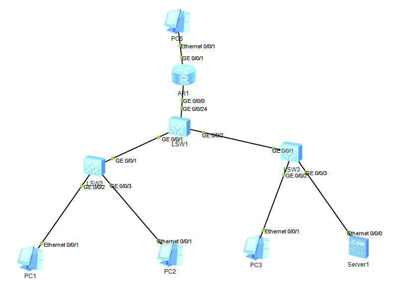

# 故障排查记录

本项目的故障分为两类：

- **第一部分**：配置过程中**自然遇到**的 3 个问题（真实排障，含走过的弯路）
- **第二部分**：主动**注入**的 3 个故障（可控实验，用于验证排查思路）

前者证明"遇到过"，后者证明"会主动验证"。



---

## 速查表

| # | 现象 | 根因 | 定位关键 |
|---|---|---|---|
| [1](#故障一vlanif-99-状态为-downdown) | `Vlanif99` down/down，服务器区不通 | LSW1 侧 Trunk 未放行 VLAN 99 | 两端 `display port vlan active` 对比 |
| [2](#故障二内网互通但无法访问外网) | 内网互 ping 正常，ping 不通外网 | AR1 未向 OSPF 域内发布默认路由 | 路由表全为 Direct，无 `0.0.0.0/0` |
| [3](#故障三核心交换机误配-default-route-advertise) | 配了默认路由发布，网络仍异常 | 命令配在非 ASBR 设备上，产生错误通告 | LSA 的 `Adv rtr` 字段 |
| [4](#故障四ospf-区域不匹配注入) | 邻居表为空，无法访问外网 | 两端 OSPF 区域号不一致 | 两侧 `State` 均为 DR，DR 指向自己 |
| [5](#故障五nat-的-acl-范围过窄注入) | 部分网段能上网，部分不能 | NAT 的 ACL 只匹配了单个网段 | 以能通的终端作对照组 |
| [6](#故障六dhcp-地址池网关配置错误注入) | 能获取 IP，但跨网段和上外网均不通 | 地址池 `gateway-list` 配错 | `ipconfig` 的网关 vs `display ip interface brief` |

---

# 第一部分 · 配置过程中遇到的问题

## 故障一：VLANIF 99 状态为 down/down

### 现象

核心交换机 LSW1 上，`Vlanif99` 接口状态为 `down/down`，服务器区（Server1）无法通信。

```text
[LSW1] display ip interface brief

Interface       IP Address/Mask      Physical   Protocol
Vlanif10        192.168.10.254/24    up         up
Vlanif20        192.168.20.254/24    up         up
Vlanif30        192.168.30.254/24    up         up
Vlanif99        192.168.99.254/24    down       down      ← 异常
Vlanif200       10.0.0.1/30          up         up
```

### 排查过程

**第一步：确认 VLAN 99 在核心侧有没有成员端口**

VLANIF 是逻辑接口，其物理状态取决于**该 VLAN 内是否存在 up 状态的成员端口**。

先看接入交换机 LSW3 的端口归属：

```text
[LSW3] display port vlan active

Port         Link Type    PVID   VLAN List
GE0/0/1      trunk        1      U: 1
                                 T: 30 99
GE0/0/2      access       30     U: 30
GE0/0/3      access       99     U: 99
```

LSW3 侧配置正确：上行 Trunk 放行了 VLAN 30 和 99，Server1 接入口 GE0/0/3 属于 VLAN 99。

再看 VLAN 99 的成员状态：

```text
[LSW3] display vlan 99

VID  Type     Ports
99   common   UT:GE0/0/3(U)
              TG:GE0/0/1(U)
```

两个端口均为 **U（Up）**，说明 LSW3 侧完全正常。

**第二步：对比核心侧 LSW1 的 Trunk 放行列表**

```text
[LSW1] display port vlan active

Port         Link Type    PVID   VLAN List
GE0/0/1      trunk        1      T: 10 20
GE0/0/2      trunk        1      T: 30          ← 缺少 99
```

### 定位

LSW1 的 GE0/0/2（连接 LSW3 的 Trunk）只放行了 VLAN 30，**未放行 VLAN 99**。

因此 VLAN 99 在 LSW1 上没有任何 up 的成员端口 → VLANIF 99 物理状态为 down → 接口 down 时不生成直连路由，也不响应 ARP。

### 解决

```text
[LSW1] interface GigabitEthernet 0/0/2
[LSW1-GigabitEthernet0/0/2] port trunk allow-pass vlan 30 99
```

恢复后 `Vlanif99` 变为 `up/up`。

### 复盘

> **VLANIF 的状态不是由 IP 配置决定的，而是由"这个 VLAN 里有没有活着的成员端口"决定的。**

两个容易踩的点：

1. **Trunk 是白名单机制**——没放行的 VLAN 流量直接丢弃。配置时必须**两端同时检查**，只查一端容易误判。
2. `port trunk allow-pass vlan` 是**覆盖**语义而非追加。写成 `vlan 99` 会把原有的 `vlan 30` 冲掉，必须写全 `vlan 30 99`。

---

## 故障二：内网互通但无法访问外网

### 现象

- PC1（VLAN 10）能 ping 通 PC2（VLAN 20）—— 三层转发正常
- PC1 **无法** ping 通外网 PC5（200.1.1.2）
- OSPF 邻居状态正常（Full）
- DHCP 正常工作

### 排查过程

**第一步：确认内网三层转发是否正常**

PC1 ping PC2 成功，说明 VLANIF 网关工作正常，**问题应该出在核心往上的一段**。

**第二步：查核心交换机的路由表**

```text
[LSW1] display ip routing-table

Destination/Mask    Proto    NextHop          Interface
10.0.0.0/30         Direct   10.0.0.1         Vlanif200
192.168.10.0/24     Direct   192.168.10.254   Vlanif10
192.168.20.0/24     Direct   192.168.20.254   Vlanif20
192.168.30.0/24     Direct   192.168.30.254   Vlanif30
192.168.99.0/24     Direct   192.168.99.254   Vlanif99

Destinations : 12    Routes : 12
```

**关键发现：12 条路由全部是 `Direct`，没有一条 `OSPF`，也没有 `0.0.0.0/0`。**

**第三步：确认 OSPF 邻居**

```text
[LSW1] display ospf peer brief

Area Id     Interface    Neighbor id    State
0.0.0.0     Vlanif200    2.2.2.2        Full
```

邻居 Full，说明 OSPF 链路本身没问题。

> 补充：本拓扑中只有 LSW1 与 AR1 运行 OSPF，接入交换机为二层设备不参与，因此**只有一个邻居是正常现象**。

**第四步：确认 AR1 是否产生默认路由的 LSA**

```text
[AR1] display ospf lsdb ase

Type      : External
Ls id     : 0.0.0.0          ← 默认路由
Adv rtr   : 2.2.2.2          ← 由 AR1 发布
Net mask  : 0.0.0.0
TOS 0  Metric: 1
E type    : 2
```

### 定位

AR1 **原本没有配置 `default-route-advertise`**，导致 OSPF 域内从未收到默认路由的 Type-5 LSA。

而 AR1 的出口 `200.1.1.0/30` 是**直连网段**（去 200.1.1.2 不需要默认路由），因此其路由表中本就不存在 `0.0.0.0/0`。在这种前提下，`default-route-advertise` 若不加 `always` 参数，OSPF 判定"本地无默认路由可发布"，不会产生 LSA。

### 解决

```text
[AR1] ospf 1
[AR1-ospf-1] default-route-advertise always
```

配置后 LSW1 路由表出现：

```text
Destination/Mask    Proto    Pre  Cost   NextHop     Interface
0.0.0.0/0           OSPF     10   1      10.0.0.2    Vlanif200
```

PC1 `ping 200.1.1.2` 成功。

### 复盘

> **路由是双向的。** 不光要让核心知道"外网在出口那边"，还要让出口主动宣告"想去外网交给我"。

三个知识点：

1. **默认路由在 OSPF 中属于外部路由（Type-5），只能由 ASBR 产生。** ASBR 是同时连接 OSPF 域和外部网络的设备。
2. **`always` 参数的必要性**：不加 `always` 时要求本地已有默认路由才发布。出口为直连网段时本地没有默认路由，必须加 `always`。
3. **`display ip routing-table <目的IP>` 比 ping 更快**：直接判断有没有可用路由。

---

## 故障三：核心交换机误配 default-route-advertise

### 现象

在出口路由器 AR1 上配置 `default-route-advertise always` 之后，核心交换机 LSW1 依然无法学到默认路由；反而是**在 LSW1 上误配了同一条命令**之后，网络出现异常，撤销后才恢复正常。

### 原因分析

`default-route-advertise` 的作用是：让本设备产生一条 Type-5 外部 LSA，向 OSPF 域内通告"默认路由的下一跳是我"。

在 LSW1（核心交换机）上配置这条命令，会产生两个后果：

**后果一：LSW1 成为"伪 ASBR"**

LSW1 本身不连接外部网络，却开始向 AR1 通告：

```text
0.0.0.0/0  →  下一跳 10.0.0.1（LSW1 自己）
```

这条通告在技术上合法，但**拓扑语义上是错的**——LSW1 自己都不知道怎么去外网。

**后果二：AR1 可能学到错误的默认路由，形成环路**

```text
AR1 的路由表：  0.0.0.0/0  →  10.0.0.1（LSW1）
LSW1 的路由表： 0.0.0.0/0  →  10.0.0.2（AR1）
```

去外网的流量变成：AR1 发给 LSW1，LSW1 又发回 AR1，**在两台设备之间循环转发**。

### 解决

```text
[LSW1] ospf 1
[LSW1-ospf-1] undo default-route-advertise
```

撤销后，LSW1 产生的错误 LSA 老化消失，域内只剩 AR1 的正确通告，网络恢复。

### 复盘

> **只有真正有出口的设备，才有资格发布默认路由。**

判断某台设备能不能配这条命令，只需要问一个问题：**这台设备自己知道怎么去外网吗？**

- 知道（连了外部网络）→ 它是 ASBR → 可以配
- 不知道（纯内网设备）→ 不是 ASBR → 配了就是制造环路

**排查技巧：看 LSA 的 `Adv rtr` 字段**

```text
[LSW1] display ospf lsdb ase

Ls id     : 0.0.0.0
Adv rtr   : 2.2.2.2      ← 应该是出口路由器的 Router ID
```

如果这里出现的是内网设备的 Router ID，说明有设备误配了该命令。

---

# 第二部分 · 故障注入实验

## 实验方法

**为什么主动制造故障**：配置正确的过程只能证明"能通"，而排查故障的过程才能证明"懂原理"。故障注入是检验理解程度最直接的方式。

**每个故障的执行步骤**：

1. **确认基线**：先证明网络是正常的
2. **先预测现象**：改配置前先判断应该出现什么结果
3. **注入故障**：修改配置
4. **验证与对比**：实际现象与预测是否一致，不一致说明理解有偏差
5. **排查定位**：不看答案，用命令自己找
6. **恢复并验证**：改回配置，确认网络恢复
7. **记录**：现象 → 排查 → 定位 → 原理

> 第 2 步"先预测"是最有价值的一步。预测错了，说明理解有漏洞——这比做对十次收获更大。

---

## 故障四：OSPF 区域不匹配（注入）

### 注入

在 AR1 上将互联链路的 OSPF 区域由 `area 0` 改为 `area 1`。

> ⚠️ **必须先删 `network` 再删 `area`**。区域里还有宣告时，`undo area 0` 会报错：
> `Error: Please delete the network command(s) of the area first.`
> 这是设备防止误删导致大片路由消失的保护机制。

```text
[AR1] system-view
[AR1] ospf 1

# ① 先清空 area 0 里的 network 宣告
[AR1-ospf-1] area 0
[AR1-ospf-1-area-0.0.0.0] undo network 10.0.0.0 0.0.0.3
[AR1-ospf-1-area-0.0.0.0] quit

# ② 才能删除该区域
[AR1-ospf-1] undo area 0

# ③ 换区域号重新宣告
[AR1-ospf-1] area 1
[AR1-ospf-1-area-0.0.0.1] network 10.0.0.0 0.0.0.3
[AR1-ospf-1-area-0.0.0.1] quit
[AR1-ospf-1] quit
```

### 现象

```text
[LSW1] display ospf peer brief
（无任何邻居条目）

[AR1] display ospf peer brief
（无任何邻居条目）
```

**两端的邻居表都是空的。**

同时 OSPF 在接口上依然运行，但**两侧都认为自己是该网段唯一的设备**：

```text
[LSW1] display ospf interface Vlanif200

Interface: 10.0.0.1 (Vlanif200)
Cost: 1       State: DR        Type: Broadcast    MTU: 1500
Designated Router: 10.0.0.1          ← 自己当 DR
Backup Designated Router: 0.0.0.0    ← 没有其他设备
```

```text
[AR1] display ospf interface GigabitEthernet0/0/0

Interface: 10.0.0.2 (GigabitEthernet0/0/0)
Cost: 1       State: DR        Type: Broadcast    MTU: 1500
Designated Router: 10.0.0.2          ← 自己当 DR
Backup Designated Router: 0.0.0.0
```

**一个 Broadcast 网段出现两个 DR，且 DR 都指向自己——说明邻居关系根本没有建立。**

正常情况下应该是：Router ID 较大的 AR1（2.2.2.2）当 DR，LSW1 为 DROther 且 DR 指向 `10.0.0.2`。

### 排查

```text
[LSW1] display current-configuration configuration ospf
[AR1]  display current-configuration configuration ospf
```

对比两侧的 `area` 配置：一侧为 `area 0.0.0.0`，另一侧为 `area 0.0.0.1`。

> `display ospf interface` 在该版本中不显示 Area 字段，需要用 `display current-configuration configuration ospf` 或 `display ospf brief` 查看。

### 定位

两端 OSPF 区域号不一致。

OSPF 收到 Hello 报文后会依次校验：**版本号 → Area ID → 认证 → Hello/Dead 间隔 → 网络掩码**。任一不匹配即丢弃报文，**在创建邻居条目之前就终止处理**。

因此区域不匹配的表现是**邻居表为空**，而不是停留在 `Init`。

### 现象辨析：什么情况才是 Init

`Init` 状态的含义是"收到了合法的 Hello，但对方的 Hello 邻居列表中没有我"，通常出现在**单向可达**场景：

```text
LSW1 ──→ AR1    Hello 能到达，AR1 建立邻居（Init）
LSW1 ←─── AR1   Hello 被阻断，LSW1 收不到
```

即：**一侧显示 Init，另一侧为空**。

| 现象 | 含义 |
|---|---|
| **两侧都为空** | 配置层面不匹配（区域 / 认证 / 定时器 / 掩码） |
| **一侧 Init，一侧为空** | 链路单向可达（回程被阻断） |

**这个区分能快速判断是"配置问题"还是"链路问题"。**

### 恢复

```text
[AR1] ospf 1
[AR1-ospf-1] area 1
[AR1-ospf-1-area-0.0.0.1] undo network 10.0.0.0 0.0.0.3
[AR1-ospf-1-area-0.0.0.1] quit
[AR1-ospf-1] undo area 1
[AR1-ospf-1] area 0
[AR1-ospf-1-area-0.0.0.0] network 10.0.0.0 0.0.0.3
[AR1-ospf-1-area-0.0.0.0] quit
[AR1-ospf-1] quit
```

验证：`peer brief` 回到 Full → 路由表出现 `0.0.0.0/0` → PC1 能 ping 通外网。

恢复后 LSW1 的接口状态会从 `DR` 变为 `DROther`，`Designated Router` 指向 `10.0.0.2` —— **这个变化本身就是最好的验证**。

### 复盘

> **判断 OSPF 邻居是否真正建立，看 `State` 和 `Designated Router` 两行就够了：**
>
> - 同网段两台设备**都是 DR**，DR 指向自己 → 邻居完全没建立
> - **一台 DR、一台 DROther**，DR 都指向同一地址 → 邻居正常

---

## 故障五：NAT 的 ACL 范围过窄（注入）

### 注入

在 AR1 上将 NAT 引用的 ACL 2000 由 `192.168.0.0/16` 收窄为 `192.168.10.0/24`：

```text
[AR1] acl number 2000
[AR1-acl-basic-2000] undo rule 5
[AR1-acl-basic-2000] rule 5 permit source 192.168.10.0 0.0.0.255
[AR1-acl-basic-2000] quit
```

### 现象

| 终端 | ping 200.1.1.2 | 报错形式 |
|---|---|---|
| PC1（VLAN 10） | ✅ 通 | — |
| PC2（VLAN 20） | ❌ 不通 | **请求超时** |
| PC3（VLAN 30） | ❌ 不通 | **请求超时** |

三台 PC 之间互 ping 均正常，说明内网路由无问题。

### 排查

**第一步：用能通的终端作对照组**

PC1 通、PC2 不通，两者走完全相同的路径：

```text
PC → 接入交换机 → LSW1（网关）→ AR1 → PC5
```

PC1 能通，说明这条路径上的**每一段都是好的**：二层、VLAN、网关、OSPF、AR1 转发全部正常。**问题一定在两者唯一的差异点——源 IP 所在网段。**

**第二步：查 NAT 会话表**

```text
[AR1] display nat session all
```

只有 VLAN 10 的会话，**没有 VLAN 20 的**。说明 PC2 的包到达了 AR1，但没有被转换。

**第三步：查 ACL**

```text
[AR1] display acl 2000

Basic ACL 2000, 1 rule
 rule 5 permit source 192.168.10.0 0.0.0.255     ← 只覆盖 VLAN 10
```

### 定位

NAT 引用的 ACL 只匹配了 `192.168.10.0/24`。

未被 ACL 匹配的流量**不会被丢弃，而是以私网源地址直接转发**。PC5 收到后无法回包（其路由表中没有 `192.168.20.0/24`），形成**"去得去、回不来"**。

### 关键理解：为什么是"超时"而不是"不可达"

包实际上**成功发出去了**：

```text
PC2 (192.168.20.5) ──→ LSW1 ──→ AR1 ──→ PC5    ✅ 到达
                                          ↓
                     源 IP 仍是 192.168.20.5（未做 NAT）
                                          ↓
PC2 ←───────── 无法回包（PC5 不认识 192.168.20.0/24） ❌
```

所以客户端表现为**一直等待直到超时**，而不是收到"目标不可达"的 ICMP。

> **这就是 NAT 存在的根本原因**：不是"为了安全"，而是**公网设备不认识私网地址**，回包找不到路。

### 为什么 NAT 的 ACL 不拦截流量

`nat outbound` 引用的 ACL 语义是**"哪些流量需要做地址转换"**，不是"哪些流量可以通行"。

```text
traffic-filter 的 ACL（门卫）：
    匹配 → permit 转发 / deny 丢弃

nat outbound 的 ACL（换装名单）：
    匹配   → 改源地址后转发
    不匹配 → 不改地址，照常转发     ← 没有"丢弃"分支
```

同一个 ACL 配在不同位置，行为完全不同。

### 验证实验（可选）

在 PC2 持续 ping 时观察 AR1 外网口的发包计数：

```text
[AR1] display interface GigabitEthernet 0/0/1 | include output
```

计数在增长，说明包确实发出去了。

再对比：把同一个 ACL 挂到门卫位置：

```text
[AR1] interface GigabitEthernet 0/0/1
[AR1-GigabitEthernet0/0/1] traffic-filter outbound acl 2000
```

此时 output 计数不再增长——包在出接口被真正丢弃。

> 做完执行 `undo traffic-filter outbound acl 2000` 撤销。

### 恢复

```text
[AR1] acl number 2000
[AR1-acl-basic-2000] undo rule 5
[AR1-acl-basic-2000] rule 5 permit source 192.168.0.0 0.0.255.255
[AR1-acl-basic-2000] quit
```

### 复盘

> **NAT 的 ACL 不是"访问控制"，而是"转换范围"。**
> 未命中的流量不会被丢弃，而是被原样转发——因此表现为超时而非不可达，极易被误判为链路问题。

---

## 故障六：DHCP 地址池网关配置错误（注入）

### 注入

在 LSW1 上将 VLAN 20 地址池的网关改为一个不存在的地址：

```text
[LSW1] ip pool vlan20
[LSW1-ip-pool-vlan20] gateway-list 192.168.20.1
[LSW1-ip-pool-vlan20] quit
```

然后在 PC2 上重新获取地址（`ipconfig /release` + `/renew`，或在图形界面中重新勾选 DHCP）。

### 现象（最具迷惑性）

| 操作 | 结果 | 说明 |
|---|---|---|
| `ipconfig` | 网关显示 `192.168.20.1` | 问题所在 |
| `ping 192.168.20.254` | ✅ **通** | 同网段直连，不经过网关 |
| `ping 192.168.10.5`（PC1） | ❌ 不通 | 跨网段需走网关 `.1`，但该地址不存在 |
| `ping 200.1.1.2` | ❌ 不通 | 同上 |

**"网关 ping 得通"这一现象会把人引向完全错误的方向。**

### 排查

```text
PC2> ipconfig

IPv4 地址  . . . . . . : 192.168.20.2
子网掩码  . . . . . . : 255.255.255.0
默认网关  . . . . . . : 192.168.20.1      ← 异常
```

对比 PC1：

```text
PC1> ipconfig

默认网关  . . . . . . : 192.168.10.254    ← 正确
```

回到 DHCP 服务器查看地址池：

```text
[LSW1] display ip pool name vlan20

  Gateway-List    : 192.168.20.1           ← 配置错误
```

同时对比接口真实地址：

```text
[LSW1] display ip interface brief

Vlanif20        192.168.20.254/24    up         up
```

**两者不一致 → 确诊。**

### 定位

DHCP 下发的网关地址（Option 3）配置错误。

PC2 获取 IP 的过程完全成功，但它记住了"网关是 192.168.20.1"。跨网段时向该地址发送 ARP 请求无人应答，包无法发出。

### 关键理解：为什么 ping 网关通不代表网关配置正确

**同网段通信不需要网关，依靠 ARP 直接解析目的 MAC。**

```text
PC2 (192.168.20.2/24) 要 ping 192.168.20.254
    ↓
判断：在同一网段 → 直接 ARP 询问 192.168.20.254 的 MAC
    ↓
LSW1 的 Vlanif20 应答
    ↓
通信成功（全程未使用"默认网关"这个配置项）
```

而跨网段才真正使用网关：

```text
PC2 要 ping 192.168.10.5
    ↓
判断：不在同一网段 → 交给默认网关
    ↓
查配置：网关 = 192.168.20.1
    ↓
ARP 询问 192.168.20.1 → 无人应答
    ↓
包发不出去
```

> **验证网关配置是否正确的唯一方法：ping 一个跨网段的地址。** 只有跨网段，才会真正使用网关。

### 补充：网关的两份配置

同一台设备的网关信息在两个位置各配置一次，**互不自动同步**：

| 配置位置 | 内容 | 作用对象 |
|---|---|---|
| `interface Vlanif20` | `ip address 192.168.20.254` | 网络本身（设备真实持有的地址） |
| `ip pool vlan20` | `gateway-list 192.168.20.254` | 终端（通过 DHCP Option 3 下发） |

华为不会因为配置了接口地址就自动填充地址池，因为地址池不总是绑定在某个接口上（详见下方说明）。

### 补充：为什么地址池不自动读取接口地址

华为存在自动模式，但用法不同：

```text
interface Vlanif20
 ip address 192.168.20.254 24
 dhcp select interface       ← 此模式下网关自动等于接口地址
```

而 `dhcp select global`（全局地址池）必须手写 `gateway-list`，原因是**地址池与接口并非一对一关系**：

| 场景 | 关系 |
|---|---|
| VRRP 双机热备 | 池网关指向虚拟 IP，与任何接口地址都不同 |
| DHCP 中继 | 地址池在服务器上，接口在核心设备上，跨设备 |
| 一台服务器管多个网段 | 每个池的网关都不同 |
| 一个接口承载多个地址段 | 一个接口对应多个池 |

且 `192.168.20.1` 在 `192.168.20.0/24` 网段内、格式完全合法，**设备只能校验语法，无法判断配置意图**。

### 恢复

```text
[LSW1] ip pool vlan20
[LSW1-ip-pool-vlan20] gateway-list 192.168.20.254
[LSW1-ip-pool-vlan20] quit
```

PC2 重新获取地址后恢复。

### 复盘

> **DHCP 只负责"把配置发给你"，从不负责"检查配置对不对"。**

它像一个尽职的快递员——把一张写错地址的单子，准确无误地送到你手上。

排查"能获取 IP 但上不了网"的标准动作：

```text
display ip interface brief       → 接口真实地址
display ip pool name vlan20      → 池中下发的网关
对比两者是否一致
```

---

# 经验总结

## 一、报错信息里的源 IP 是最有价值的线索

| ping 提示 | ICMP 类型 | 含义 | 下一步 |
|---|---|---|---|
| 无法访问目标网<br>Destination net unreachable | Type 3 Code 0 | 某台设备路由表里没有该网段 | 看报错源 IP，登到那台设备查 `display ip routing-table <IP>` |
| 无法访问目标主机<br>Destination host unreachable | Type 3 Code 1 | 路由有，但下一跳 ARP 解析失败 | 查下一跳设备是否在线、接口是否 up |
| 请求超时<br>Request timed out | 无 ICMP 返回 | 包发出去了没回来，或被静默丢弃 | 查回程路由、NAT、ACL |
| TTL 过期<br>TTL expired | Type 11 | 路由环路 | 查是否有互相指向的默认路由 |

## 二、先 ping 网关，把问题切成两半

```text
ping 网关
├─ 不通 → 二层问题（VLAN / Trunk / 接口 / 网线 / ARP）
└─ 通   → 三层问题（路由 / NAT / 回程）
```

> ⚠️ 能 ping 通网关**不代表**网关配置正确（见故障六）。同网段通信不经过网关。

## 三、排查顺序：从下往上

```text
物理层   → 接口 up 吗              display ip interface brief
链路层   → VLAN 归属对吗            display port vlan active
网络层   → 有路由吗                display ip routing-table <目的IP>
路由协议 → 邻居 Full 吗             display ospf peer brief
         → LSA 有吗                display ospf lsdb ase
应用配置 → NAT / ACL / DHCP 池       display nat outbound / display acl / display ip pool
```

## 四、现象相同，病因可能不同

"请求超时"这一个提示，在本项目中对应了三种完全不同的病因：

| 故障 | 包走到哪 | 谁丢弃的 |
|---|---|---|
| 二：无默认路由 | LSW1 就停 | LSW1 查表失败 |
| 五：NAT ACL 过窄 | 一直到达 PC5 | PC5 无法回包 |
| 六：网关配错 | 卡在 PC2 自己 | PC2 的 ARP 失败 |

**所以不能只看现象，要结合"包走到哪"和"哪台设备的路由表缺条目"来判断。**

## 五、配置正确 ≠ 业务正常

本项目的 6 个故障中，有 4 个属于"每一步命令都没报错，但业务不通"：

- VLAN 未放行（无告警，静默丢弃）
- 默认路由未发布（无告警，查表失败）
- NAT ACL 范围过窄（无告警，部分流量失效）
- DHCP 网关配错（无告警，终端拿到错误配置）

**网络设备的默认行为是"能用就转发"，不会主动提示配置不合理。** 因此验证必须依赖 `display` 命令的实际输出，而不是"我配了应该就行了"。
