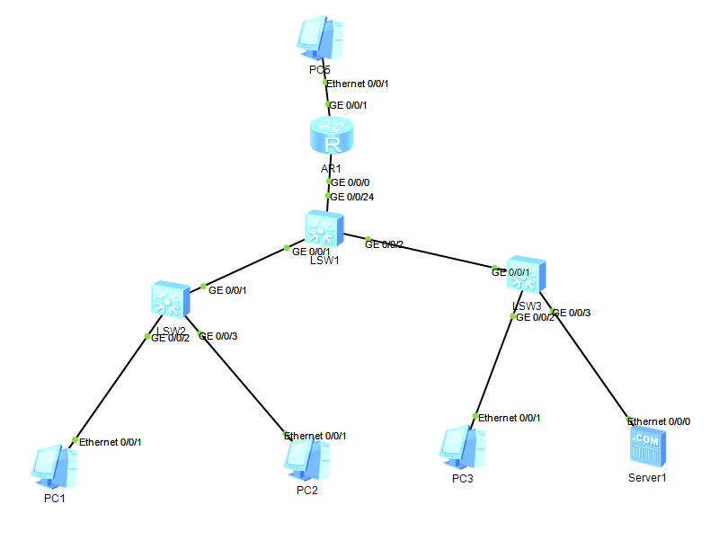

# 网络工程实践记录

网络工程专业实验与实践项目整理，涵盖企业网组网、故障排查、Web 安全与自动化运维。

**环境**：华为 eNSP 1.3 ｜ VRP 5.170 ｜ 合肥师范学院 网络工程

---

## 项目列表

| # | 项目 | 方向 | 状态 |
|---|---|---|---|
| 01 | [中小型企业网络规划与部署](01-enterprise-network/) | 路由交换 · 故障排查 | 已完成 |
| 02 | Web 常见漏洞复现（DVWA） | 网络安全 | 进行中 |
| 03 | 网络设备批量配置脚本 | Python 自动化 | 进行中 |

---

## 01 · 中小型企业网络规划与部署

基于 eNSP 搭建「双接入 + 三层核心 + 出口路由」架构，完成 VLAN 划分、DHCP、OSPF、NAT、ACL 的配置，并记录了 **6 个故障**的完整排查过程（3 个自然遇到 + 3 个主动注入）。



**技术要点**

- 三层交换机 VLANIF 作为各业务网段网关，Trunk 承载跨交换机流量
- DHCP 全局地址池为终端自动分配地址
- OSPF 单区域实现内网互通，`default-route-advertise` 向域内下发默认路由
- NAT（Easy IP）实现私网访问外网
- 高级 ACL 隔离访客区与服务器区

**目录**

```
01-enterprise-network/
├── README.md              项目说明与网段规划
├── troubleshooting.md     6 个故障排查记录 ★
├── topology.topo          eNSP 工程文件（拓扑结构）
├── config/                各设备配置文本
│   ├── LSW1.txt
│   ├── LSW2.txt
│   ├── LSW3.txt
│   └── AR1.txt
├── images/
│   ├── topology.png       网络拓扑图
│   └── README.md          截图清单
└── notes/
    └── ospf-notes.html    OSPF 学习笔记（图解）
```

> `topology.topo` 仅包含网络结构与连线，各设备的实际配置见 `config/` 目录下的文本文件。

**核心文件**：[troubleshooting.md](01-enterprise-network/troubleshooting.md) —— 记录了 6 个故障的完整排查过程，包括 VLANIF 状态异常、默认路由缺失、ASBR 配置位置错误、OSPF 区域不匹配、NAT ACL 范围过窄、DHCP 网关配置错误。

---

## 关于本仓库

所有实验均在 eNSP 模拟环境中完成，配置经过实际验证（可通过 `ping`、`display` 命令复现结果）。

配置文件的导出方式：

```text
<设备> display current-configuration
```

---

## 联系方式

- GitHub：[@bandaofanhe999](https://github.com/bandaofanhe999)
- 求职方向：网络安全实习生（合肥）

> 如需联系，请通过 GitHub Issue 或站内私信。公开仓库不放置个人邮箱。
